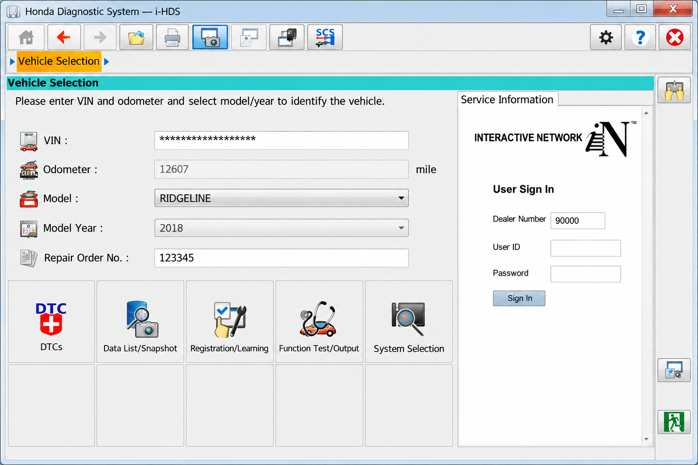
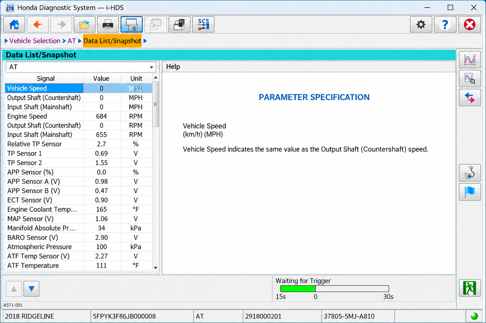
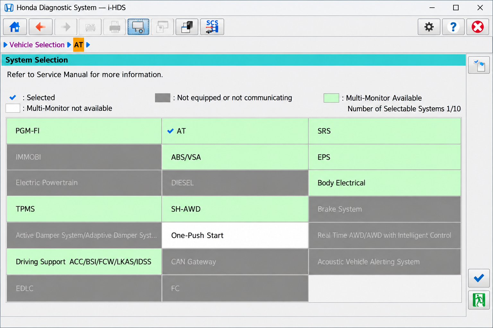

# Honda Diagnostic System - Rust-Based Honda Vehicle Diagnostics Research Platform

HDS Honda maintains Honda Diagnostic System, a community research project for exploring vehicle diagnostics through OBD-II, UDS, KWP2000, SAE J2534 passthrough devices, and SocketCAN.

## Features (Current)

[](https://hds-honda.github.io/honda-diagnostic-system/i-HDS-honda)

- CAN traffic tracing.
- OBD-II service support.
- Automated UDS and KWP2000 scanning.
- Diagnostic trouble-code reading and clearing.
- ECU identification and diagnostic-session control.
- VIN and live-data requests.
- SAE J2534 and SocketCAN communication layers.
- Native Rust diagnostic windows and reusable protocol schemas.

Honda Diagnostic System provides foundations relevant to Honda HDS live data, Honda HDS bidirectional controls, and Honda HDS diagnostic reprogramming research. Honda HDS ECU programming, Honda HDS immobilizer programming, and production reprogramming are not promised without authorized software, vehicle-specific definitions, and appropriate security access.

## Screenshots



## Diagnostic Adapter API Support

- **SAE J2534 passthrough:** Implemented through the [passthrough API](app_rust/src/commapi/passthru_api.rs) and [passthrough integration](app_rust/src/passthru.rs).
- **SocketCAN:** Implemented for Linux through the [SocketCAN API](app_rust/src/commapi/socket_can_api.rs).
- **Protocol dispatch:** Organized through the [communication API](app_rust/src/commapi/comm_api.rs) and [interface abstraction](app_rust/src/commapi/iface.rs).
- **OBD-II:** Services 01 through 10 are represented under [the OBD-II protocol module](app_rust/src/commapi/protocols/obd2/mod.rs).
- **UDS:** Diagnostic sessions, data reads, and DTC reads are represented under [the UDS module](app_rust/src/commapi/protocols/uds/mod.rs).
- **KWP2000:** ECU reset, identification, DTC status, and session operations are represented under [the KWP2000 module](app_rust/src/commapi/protocols/kwp2000/mod.rs).

A Honda HDS HIM or Honda HIM interface is not automatically compatible merely because it uses a Honda HDS cable. Honda HDS supported interfaces depend on drivers, protocol exposure, operating system support, and whether the hardware presents a usable Honda HDS J2534 interface.

## Platform Support

| OS | Adapter support | Note |
|---|---|---|
| Windows | SAE J2534 | The primary environment for commercial Honda J2534 drivers. |
| Linux | SocketCAN | Hardware and kernel configuration are required. |
| Linux | Compatible passthrough implementations | Support depends on the device driver. |
| macOS | Compatible passthrough implementations | Support depends on a cross-platform driver. |

Platform automation is represented by the [Windows workflow](.github/workflows/app-windows-i686-msvc.yml), [Linux workflow](.github/workflows/app-linux.yml), and [macOS workflow](.github/workflows/macos.yml).

## Launch Args

- `-debug_ui` enables interface debugging and displays layout constraints and boundaries.

The application entry point is [app_rust/src/main.rs](app_rust/src/main.rs), while launch and window coordination are implemented in [launcher.rs](app_rust/src/windows/launcher.rs) and [window.rs](app_rust/src/windows/window.rs).

## Questions And Answers

### What Is HDS For Honda?

HDS means Honda Diagnostic System, the dealer-level diagnostic environment associated with Honda and Acura vehicles. Its current evolution is commonly called Honda i-HDS. Official software can perform vehicle identification, DTC operations, live-data viewing, functional tests, and supported ECU procedures when used with valid access and compatible hardware.

HDS Honda uses Honda Diagnostic System as the repository name for an open diagnostic research implementation.

## Project Description

Honda Diagnostic System is a Rust-based vehicle ECU diagnostic platform. The design separates communication interfaces, diagnostic protocols, reusable schemas, and native interface windows so that HDS Honda can study Honda HDS OBD2 communication without embedding proprietary dealer resources.



The current interface includes a [CAN tracer](app_rust/src/windows/cantracer.rs), [diagnostic scanner](app_rust/src/windows/diag_scanner.rs), [manual diagnostic view](app_rust/src/windows/diag_manual.rs), [OBD view](app_rust/src/windows/obd.rs), and protocol-specific diagnostic sessions. The implementation can support experimentation related to Honda HDS Civic, Honda HDS Accord, Honda CR-V HDS, and Honda HDS Acura diagnostics only after the required vehicle definitions have been independently verified.

## Usage

Build or run the native application through its Rust manifest:

```console
cargo run --manifest-path app_rust/Cargo.toml
```

The diagnostic home is implemented in [diag_home.rs](app_rust/src/windows/diag_home.rs). Custom, JSON, UDS, and KWP2000 sessions are organized under [the diagnostic-session module](app_rust/src/windows/diag_session/mod.rs).

### OBD-II Services

Honda Diagnostic System retains separate handlers for standard OBD-II services:

- Service 01 reads current powertrain data.
- Service 02 reads freeze-frame data.
- Service 03 reads stored diagnostic trouble codes.
- Service 04 clears emissions-related diagnostic information.
- Services 05 through 10 provide the corresponding standardized test, monitoring, identification, and permanent-code operations.

DTC definitions are implemented in [codes.rs](app_rust/src/commapi/protocols/obd2/codes.rs). Clearing KWP2000 diagnostic information is implemented in [clear_diag_information.rs](app_rust/src/commapi/protocols/kwp2000/clear_diag_information.rs).

### CBF Conversion

The retained CBF parser converts Daimler CBF diagnostic definitions into the shared JSON-oriented schema. It is an auxiliary compatibility component and does not provide Honda calibration data.

```console
cargo run --manifest-path CBFParser/Cargo.toml -- INPUT.CBF
```

The parser separates [container reading](CBFParser/src/caesar/container.rs), [diagnostic services](CBFParser/src/diag/service.rs), [presentations](CBFParser/src/diag/presentation.rs), and [ECU variants](CBFParser/src/ecu/variant.rs).

## Common Code

The [common crate](common/Cargo.toml) contains reusable schema and random-access-file components shared by the application and parser.

- [Diagnostic trouble-code schema](common/src/schema/diag/dtc.rs)
- [Diagnostic service schema](common/src/schema/diag/service.rs)
- [ECU variant schema](common/src/schema/variant.rs)
- [Random-access file support](common/src/raf.rs)

This separation keeps Honda Diagnostic System protocol data independent from interface presentation and hardware transport.

## Repository Structure

- [`app_rust`](app_rust/Cargo.toml) contains the Honda Diagnostic System desktop application.
- [`app_rust/src/commapi`](app_rust/src/commapi/mod.rs) contains transport and adapter abstractions.
- [`app_rust/src/commapi/protocols`](app_rust/src/commapi/protocols/mod.rs) contains OBD-II, UDS, and KWP2000 operations.
- [`app_rust/src/windows`](app_rust/src/windows/mod.rs) contains the native diagnostic interface.
- [`CBFParser`](CBFParser/Cargo.toml) contains the CBF conversion utility.
- [`common`](common/Cargo.toml) contains shared diagnostic schemas.
- [`.github/workflows`](.github/workflows/build.yml) contains build automation.

## DBC File Basics

A DBC file describes how raw CAN frames map to meaningful messages and signals. A vehicle may have several CAN networks, and each network can use different identifiers, scaling rules, units, checksums, and message frequencies.

Honda Diagnostic System does not retain a complete Honda DBC collection in the selected files. CAN traffic must therefore be interpreted cautiously, with signal sizes, units, checksums, and uncertain bits documented before any transmission is attempted.



### What Does "HDS Car" Mean?

“HDS car” is not a formal Honda model designation. The phrase normally refers to a Honda or Acura vehicle being diagnosed with Honda Diagnostic System or Honda i-HDS.

Compatibility cannot be inferred from that phrase alone. Model, year, market, ECU generation, communication protocol, adapter, subscription entitlement, and software version can all affect whether Honda HDS diagnostic system functions are available.

## Compatibility

Honda HDS vehicle compatibility is broader than basic OBD-II compatibility. Standard emissions data may work through Honda HDS OBD2 while body, restraint, immobilizer, transmission, and driver-assistance modules require manufacturer-specific requests and authorized procedures.

### Which Hondas To Stay Away From?

Honda Diagnostic System should not be used to create a blanket list of Honda models to avoid. Reliability decisions require service history, recalls, inspection results, model year, powertrain, market, and vehicle condition rather than diagnostic-software compatibility alone.

For diagnostic work, avoid unsupported procedures instead of avoiding an entire model. Do not send unverified commands, perform Honda HDS ECU reprogramming with unstable power, or attempt Honda HDS immobilizer programming without authorization. HDS Honda does not currently include a validated model-year compatibility matrix, so Honda HDS Civic, Honda HDS Accord, and Honda CR-V HDS support must be confirmed for the exact vehicle.

## Software

Access commonly requires a Honda HDS subscription, and the Honda i-HDS subscription price or Honda HDS price may vary by region, duration, and service level.

### Where Can I Buy Honda HDS?

Official Honda HDS and i-HDS access should be purchased directly through Honda’s official service-information or software store for the applicable region. That route provides legitimate subscription terms, current Honda HDS software updates, and the documentation needed for supported interfaces.

Marketplace listings for a Honda HIM, HDS HIM, Honda HDS cable, or Honda HDS passthrough device should not be assumed genuine or compatible. Buyers should verify licensing, driver availability, supported vehicles, and whether the interface exposes an approved Honda J2534 connection.

## SAE J2534

SAE J2534 defines communication between a computer and a vehicle through a passthrough device. Manufacturers use it for emissions-related ECU reprogramming and may expose additional diagnostic functionality through their own applications.

Within Honda Diagnostic System, the abstraction is represented by [passthru_api.rs](app_rust/src/commapi/passthru_api.rs). A Honda HDS J2534 setup still requires the correct driver, interface firmware, vehicle connection, voltage support, and authorized Honda HDS ECU reprogramming software.

## Safety Model

Vehicle diagnostics can change ECU state, clear evidence needed for repair, activate components, or interrupt module programming. Use a stable power supply, preserve diagnostic logs, confirm ECU identity, and understand every request before transmission.

Read-only identification and Honda HDS live data should precede Honda HDS bidirectional controls. Reprogramming should only occur with verified calibration data and recovery procedures. SocketCAN and passthrough development must be isolated from public-road operation.

## Code Rigor

Honda Diagnostic System includes build, release, dependency, and static-analysis automation:

- [Build workflow](.github/workflows/build.yml)
- [CodeQL analysis](.github/workflows/codeql-analysis.yml)
- [Release workflow](.github/workflows/release.yml)
- [Dependency configuration](.github/dependabot.yml)
- [CLI tests](app_rust/src/cli_tests/mod.rs)

Protocol changes should be tested against simulated or bench ECUs before connection to a vehicle. Error handling must account for timeouts, negative responses, transport fragmentation, incorrect addressing, and communication loss.

## Contributions

Contributions to HDS Honda should remain focused on lawful interoperability, diagnostic safety, and independently documented behavior. Reports can use the [bug template](.github/ISSUE_TEMPLATE/bug_report.md), while proposals can use the [feature-request template](.github/ISSUE_TEMPLATE/feature-request.md).

Pull requests should follow the [pull-request template](.github/pull_request_template.md). Contributions must not include proprietary Honda binaries, dealer credentials, subscription bypasses, confidential calibration packages, or unauthorized security material.

## Diagnostic Vocabulary

hds honda, honda hds diagnostic system, honda hds software, honda hds j2534, honda hds obd2, honda-hds, honda-diagnostics, automotive-diagnostics, vehicle-diagnostics, ecu-programming, j2534, obd2, can-bus, ihds

## License

See [LICENSE](LICENSE).
